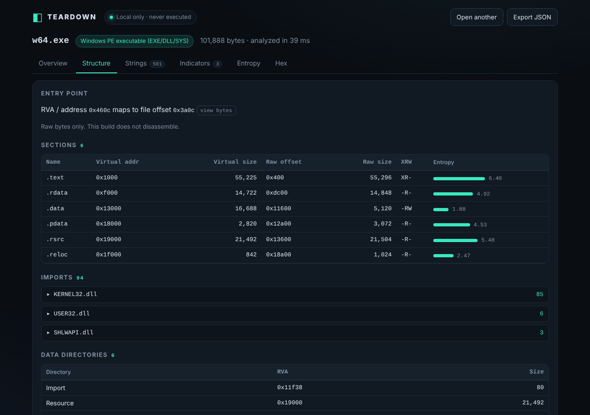

# 2026-10-17

**Featured build: [Teardown](teardown/)**, a drag-and-drop static file analyzer that runs entirely in the browser. It was built from a recon of REA ("Reverse Engineer Anything"), the project that trended this week.

- [`REA-RECON.md`](REA-RECON.md): what REA actually is, why it went viral, what is verified and what is not
- [`teardown/`](teardown/): the app, with its own README, screenshots, tests and safety notes
- [`RESEARCH.md`](RESEARCH.md): earlier research pass (GeoSports); its draft build was dropped

Not deployed, by design.

## Status
Teardown builds, passes its Node smoke tests (ELF, PE, Mach-O, ZIP, PDF, PNG, corrupt and truncated inputs) and disassembler tests, and was driven end to end (including the Disassembly tab on an ELF and a PE file) in headless Chromium with real drag-and-drop and file-picker uploads, with no console errors and no Content-Security-Policy violations.

It was built offline using React and esbuild already present on the build machine, because the npm registry was blocked there. `npm install` has therefore not been run against the real registry for this project; if it misbehaves, that is the first place to look.
