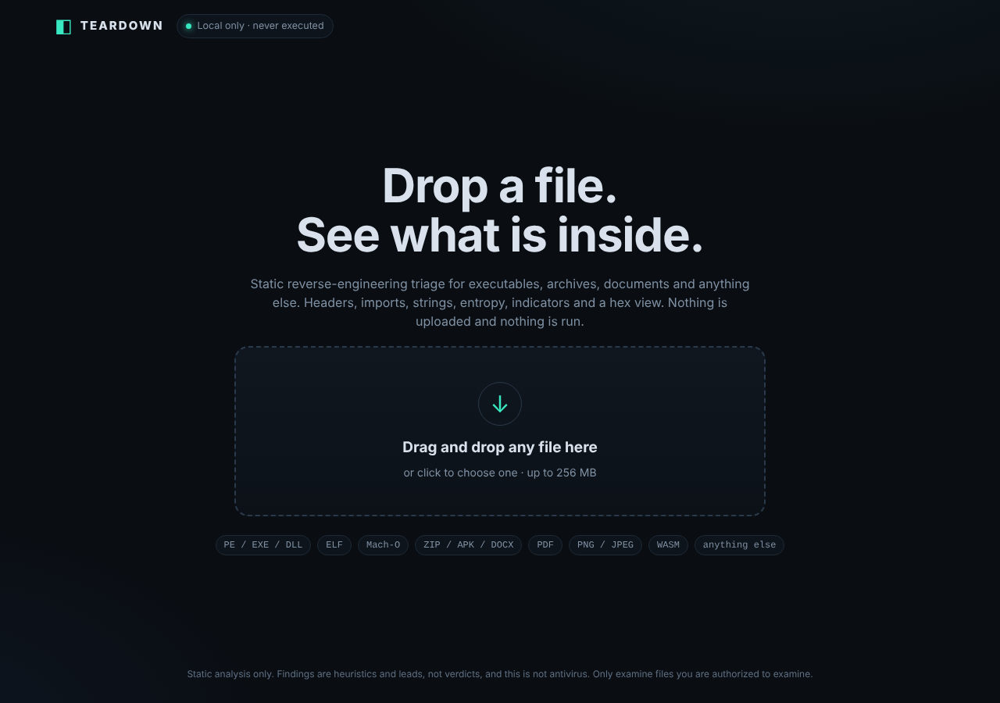
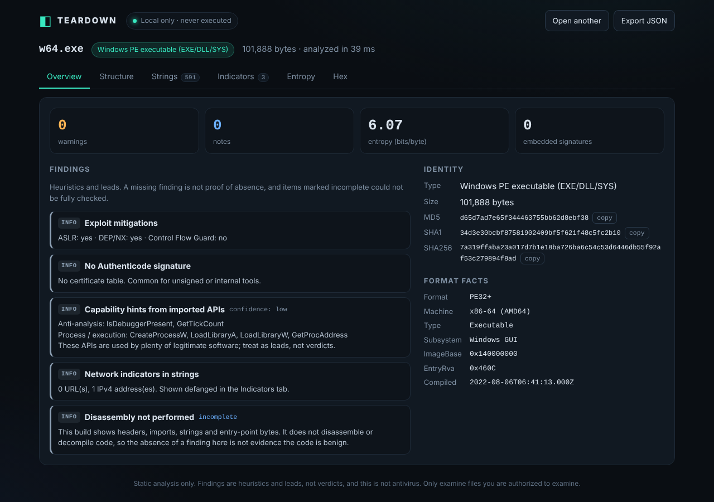
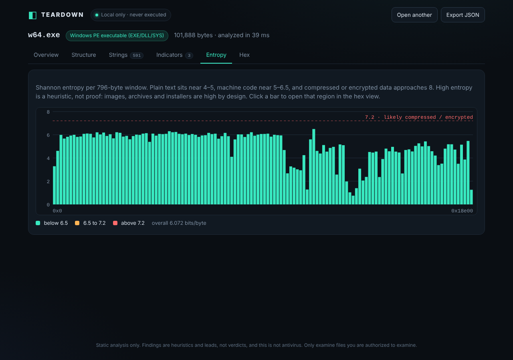
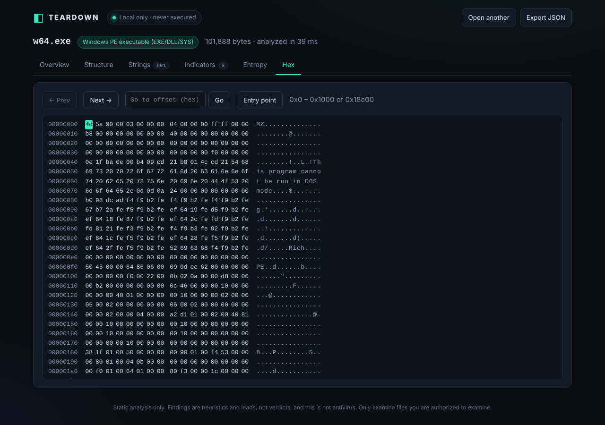

# Teardown

Drag and drop any file and get a static reverse-engineering triage: file type, headers, sections, imports, strings, entropy, indicators and a hex view. It runs entirely in your browser. The file is never uploaded and never executed.


*A small Windows executable (a benign launcher stub) dropped onto Teardown: structure tab with entry point, sections and imports.*

| Landing | Overview |
|---|---|
|  |  |

| Entropy profile | Hex view |
|---|---|
|  |  |

## What it does

- **Identifies** the file by magic bytes (PE, ELF, Mach-O and fat Mach-O, ZIP and its relatives, PDF, PNG, JPEG, WASM, Java class, gzip, 7z, RAR, SQLite, scripts, text, and more).
- **Parses structure** for PE, ELF, Mach-O, ZIP (APK/JAR/DOCX/XLSX/IPA detection), PDF, PNG, JPEG, WASM and Java class files.
- **Findings** with a severity, a confidence level, and an `incomplete` flag where a stage could not fully check something. Missing findings are never presented as proof of absence.
- **Strings** (ASCII and UTF-16LE) with offsets, search and a minimum-length slider. Click a row to jump to it in the hex view.
- **Indicators**: URLs, domains, IPs, emails, Windows and Unix paths, registry keys. Defanged by default.
- **Entropy** per window as a chart, with a clearly labelled heuristic threshold.
- **Embedded-file carving** for signatures found past offset 0.
- **Hashes**: MD5, SHA-1, SHA-256.
- **Export** the full report as JSON.

## Run it

```
npm install
npm run build        # bundles to dist/
npm run dev          # dev server with live reload on http://localhost:5173
npm test             # analyzer smoke tests (Node)
```

Open `dist/index.html` through any static file server. Web Workers and Web Crypto need `http://localhost` or HTTPS, not `file://`.

## Safety model

- Parsers only read bytes. Nothing is `eval`ed, run, emulated, or rendered as HTML.
- Parsing happens in a Web Worker, so a malformed file cannot freeze the page.
- A strict Content-Security-Policy ships in `index.html`: scripts and the worker load from the same origin only, and `connect-src 'none'` in production builds means a parser bug cannot send file contents anywhere.
- Every stage is wrapped. A corrupt header becomes a "stage failed" finding, not a crash. Reads are bounds-checked and string scans are capped.
- Hex view reads one 4 KB page at a time from the `File` handle, so large files do not get duplicated in memory. Files up to 256 MB are accepted.

## Limits (read these)

- **No disassembly or decompilation yet.** PE/ELF/Mach-O results are headers, imports, strings and entry-point bytes. Findings are leads, not verdicts, and this is not antivirus.
- PDF scanning is a raw keyword pass. Compressed object streams are not decompressed, and the report says so.
- Authenticode and code signatures are detected, not validated.
- Entropy and API-name hints are heuristics. Compressed resources and ordinary programs trigger them too.
- Only examine files you are authorized to examine. Analyzing third-party software can still breach its license terms even when everything stays local.

## Relationship to REA

REA ("Reverse Engineer Anything") is a CLI and MCP server that lets AI coding agents drive tools such as Ghidra, Hopper and IDA. It has no upload UI or drag-and-drop flow. Teardown is a different, smaller product: a private, zero-install-footprint viewer for the static triage step. It is not a clone and shares no code or branding. See `../REA-RECON.md` for the research behind that call.

## Roadmap

- Optional lazy-loaded disassembly of the entry point (a WASM Capstone build, self-hosted)
- Local YARA rule scanning
- Desktop builds (DMG for macOS, EXE for Windows) by wrapping the same static bundle, for example with Tauri or Electron, with the same no-network policy
- Opt-in hash lookups that send only the hash

## Layout

```
src/core/     pure analysis modules (signatures, pe, elf, macho, zip, misc, scan, hashes, analyze)
src/worker.js Web Worker entry
src/App.jsx + src/components/   React UI
test/smoke.mjs                  Node smoke tests on real and synthetic files
build.mjs                       esbuild bundler and dev server
```
