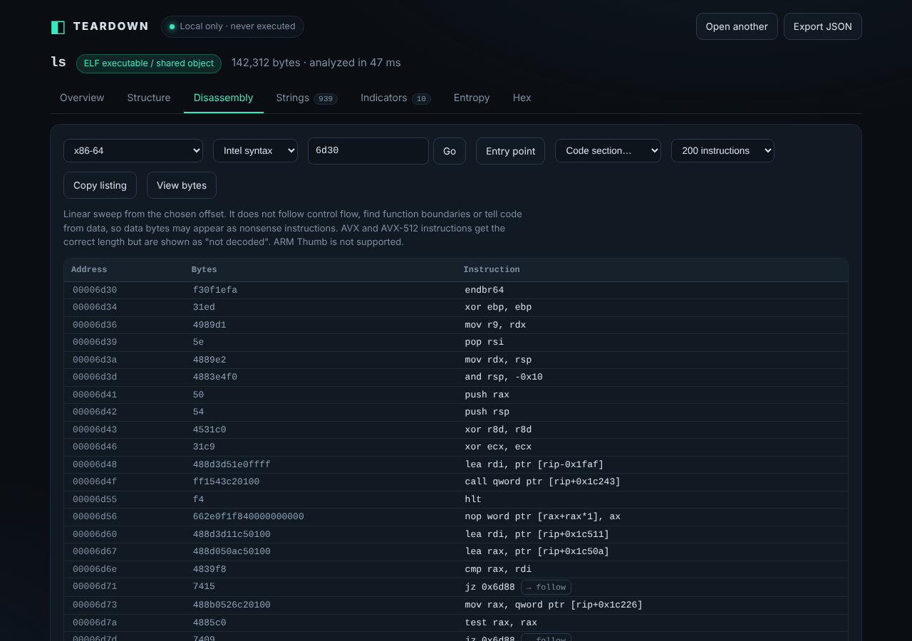

# Teardown

Drag and drop any file and get a static reverse-engineering triage: file type, headers, sections, imports, strings, entropy, indicators, a hex view and disassembly. It runs entirely in your browser. The file is never uploaded and never executed.


*A small Windows executable (a benign launcher stub) dropped onto Teardown: structure tab with entry point, sections and imports.*

| Landing | Overview |
|---|---|
|  |  |

| Entropy profile | Hex view |
|---|---|
|  |  |



*Disassembly tab on the entry point of a Linux `ls` binary.*

## What it does

- **Identifies** the file by magic bytes (PE, ELF, Mach-O and fat Mach-O, ZIP and its relatives, PDF, PNG, JPEG, WASM, Java class, gzip, 7z, RAR, SQLite, scripts, text, and more).
- **Parses structure** for PE, ELF, Mach-O, ZIP (APK/JAR/DOCX/XLSX/IPA detection), PDF, PNG, JPEG, WASM and Java class files.
- **Findings** with a severity, a confidence level, and an `incomplete` flag where a stage could not fully check something. Missing findings are never presented as proof of absence.
- **Strings** (ASCII and UTF-16LE) with offsets, search and a minimum-length slider. Click a row to jump to it in the hex view.
- **Indicators**: URLs, domains, IPs, emails, Windows and Unix paths, registry keys. Defanged by default.
- **Entropy** per window as a chart, with a clearly labelled heuristic threshold.
- **Embedded-file carving** for signatures found past offset 0.
- **Hashes**: MD5, SHA-1, SHA-256.
- **Disassembles** x86-64, x86-32, ARM64, ARM (ARM mode), RISC-V 64 and PowerPC64 from the entry point, a code section or any offset. Intel or AT&T syntax for x86, followable direct branches, copyable listing. The decoder is Go's `golang.org/x/arch` compiled to WebAssembly and bundled, loaded only when you open the tab.
- **Export** the full report as JSON.

## Run it

```
npm install
npm run build        # bundles to dist/
npm run dev          # dev server with live reload on http://localhost:5173
npm test             # analyzer smoke tests and disassembler tests (Node)
npm run build:wasm   # only if you change wasm/ (needs Go; no network required)
```

Open `dist/index.html` through any static file server. Web Workers and Web Crypto need `http://localhost` or HTTPS, not `file://`.

## Safety model

- Parsers only read bytes. Nothing is `eval`ed, run, emulated, or rendered as HTML.
- Parsing happens in a Web Worker, so a malformed file cannot freeze the page. The disassembler decodes bytes to text in a second worker; it never executes them.
- A strict Content-Security-Policy ships in `index.html` (`connect-src 'none'` in production builds). **Correction to an earlier claim:** a `<meta>` CSP does not govern dedicated workers; we tested this, and a same-origin worker still issued an outbound request. So workers are protected two other ways: `public/_headers` carries the same policy as an HTTP header (the real control, which your host must actually send; it is copied to `dist/`), and `src/lockdown.js` removes `fetch`, `XMLHttpRequest`, `WebSocket` and similar from both workers before any file bytes are read (tested). The lockdown is defense in depth, not a hard sandbox.
- `'wasm-unsafe-eval'` is in `script-src` only so the bundled disassembler can be compiled. It does not enable `eval()`.
- Every stage is wrapped. A corrupt header becomes a "stage failed" finding, not a crash. Reads are bounds-checked and string scans are capped.
- Hex view reads one 4 KB page at a time from the `File` handle, so large files do not get duplicated in memory. Files up to 256 MB are accepted.

## Limits (read these)

- **No decompilation, function discovery or control-flow graph.** Disassembly is a linear sweep: it decodes from the offset you choose and cannot tell code from data, so data may show as nonsense instructions. Findings are leads, not verdicts, and this is not antivirus.
- **Disassembler accuracy** (measured, small samples): x86-64 instruction boundaries matched GNU objdump 100% on `/bin/ls` and five libc regions, with about 99% identical mnemonics after alias normalization. AVX/AVX-512 (VEX/EVEX) instructions get the right length, but about 18% of those in our test set show "mnemonic not decoded". ARM64 and RISC-V mnemonics matched LLVM on small assembled samples; ARM and PPC64LE boundaries matched with one mnemonic difference each. **ARM Thumb is not supported.** Treat the listing as a reading aid, not ground truth.
- PDF scanning is a raw keyword pass. Compressed object streams are not decompressed, and the report says so.
- Authenticode and code signatures are detected, not validated.
- Entropy and API-name hints are heuristics. Compressed resources and ordinary programs trigger them too.
- Only examine files you are authorized to examine. Analyzing third-party software can still breach its license terms even when everything stays local.

## Relationship to REA

REA ("Reverse Engineer Anything") is a CLI and MCP server that lets AI coding agents drive tools such as Ghidra, Hopper and IDA. It has no upload UI or drag-and-drop flow. Teardown is a different, smaller product: a private, zero-install-footprint viewer for the static triage step. It is not a clone and shares no code or branding. See `../REA-RECON.md` for the research behind that call.

## Roadmap

- Function discovery and cross-references on top of the disassembler; Thumb and AVX mnemonic support
- Local YARA rule scanning
- Desktop builds (DMG for macOS, EXE for Windows) by wrapping the same static bundle, for example with Tauri or Electron, with the same no-network policy
- Opt-in hash lookups that send only the hash

## Layout

```
src/core/     pure analysis modules (signatures, pe, elf, macho, zip, misc, scan, hashes, analyze)
src/worker.js Web Worker entry (analysis)
src/disasm/   disassembler worker, client and engine wrapper
src/lockdown.js removes network APIs inside workers
wasm/         Go source for the disassembler plus the built disasm.wasm
vendor/       wasm_exec.js from Go 1.24.7 (must match the compiler version)
public/_headers CSP and security headers to send in production
src/App.jsx + src/components/   React UI
test/smoke.mjs, disasm.mjs      Node tests on real and synthetic files
build.mjs                       esbuild bundler and dev server
```

## Third-party notices

- The disassembler uses decoders from [`golang.org/x/arch`](https://pkg.go.dev/golang.org/x/arch) (BSD 3-Clause; see `wasm/LICENSE-x-arch` and `wasm/PATENTS-x-arch`), copied from Go 1.24.7's vendor directory. One local patch: `x86asm/decode.go` sign-extends 32-bit displacements. We also added `endbr32/64` and VEX/EVEX length handling in `wasm/main.go`.
- `vendor/wasm_exec.js` is from the Go distribution (BSD 3-Clause, Copyright The Go Authors).
- Built offline: the npm registry was blocked in the build environment, so dependencies were React and esbuild already present on the machine. `npm install` has not been run against the real registry for this project.
