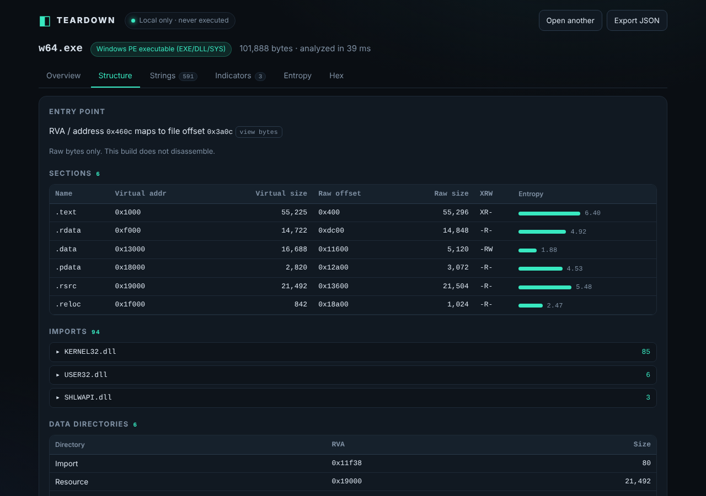

# reverse-magic

Each day this repo looks at a vibe-coded project that is trending, writes up what is actually true about it, and then builds an original app based on the most promising idea. Nothing here is deployed; everything runs on your own machine.




| Folder | What it is |
|---|---|
| [`teardown/`](teardown/) | **Teardown**, the current build: a drag-and-drop static file analyzer that runs locally |
| [`research/`](research/) | Recon notes: [REA](research/REA-RECON.md) (the trending project Teardown was based on) and an [earlier pass](research/RESEARCH.md). Each covers what the project is, why it took off, which claims are verified, and sources |

## Teardown (current build)

Teardown shows you what is inside a file without running it. Drop an executable, archive, document or any other file onto the page and it gives you:

- **Overview**: file type, size, MD5/SHA-1/SHA-256 hashes, and findings with severity and confidence
- **Structure**: headers, sections, imports and entry point for PE (Windows), ELF (Linux), Mach-O (macOS), ZIP/APK/JAR/DOCX, PDF, PNG, JPEG, WASM and Java class files
- **Disassembly**: machine code decoded to assembly for x86-64, x86-32, ARM64, ARM, RISC-V 64 and PowerPC64
- **Strings**: readable text found in the file, searchable
- **Indicators**: URLs, domains, IPs, emails, file paths and registry keys (shown defanged)
- **Entropy**: a chart that highlights packed or encrypted regions
- **Hex**: a raw byte view you can jump into from any other tab

Everything happens in your browser. The file is never uploaded and never executed.

### How to use it

You need [Node.js](https://nodejs.org/) 18 or newer.

```sh
cd teardown
npm install
npm run dev          # opens a dev server at http://localhost:5173
```

Then:

1. Open http://localhost:5173 in your browser.
2. Drag a file onto the drop zone, or click it to pick a file (up to 256 MB).
3. Switch between the tabs above. Clicking an offset, string or indicator jumps to that spot in the Hex view; clicking an entry point or code section opens it in Disassembly.
4. Click **Export JSON** to save the full report.
5. Click the logo to clear the file and analyze another.

Other commands:

```sh
npm run build        # production build into dist/
npm test             # parser and disassembler tests
```

To serve a production build, put `dist/` behind any static file server (for example `npx serve dist`). It will not work if opened straight from disk as `file://`, because browsers block Web Workers there.

### Tutorial: your first teardown

About ten minutes. You'll look inside a program that's already on your computer, then find something hidden in an image. Start the dev server first (`npm run dev` in `teardown/`) and open http://localhost:5173.

#### Part 1: look inside a program you already have

Work on a copy, so the file picker can reach it easily:

| System | Command |
|---|---|
| Linux | `cp /bin/ls ~/ls-copy` |
| macOS | `cp /bin/ls ~/Desktop/ls-copy` |
| Windows | `copy C:\Windows\System32\notepad.exe %USERPROFILE%\Desktop\` |

Drag the copy onto the page. Analysis takes a second or two. Then go through the tabs left to right:

1. **Overview.** At the top you'll see the file type (for example *ELF executable / shared object* on Linux, *Mach-O universal* on a Mac, *Windows PE* on Windows), the size and the hashes. Each hash has a **copy** button; paste a SHA-256 into a search engine or a malware database to see whether the file is already known. Below that are the **Findings**. For a normal system program they're mostly INFO, such as *Non-executable stack (NX)* or *Exploit mitigations*: a description of how the program was built, not a warning. WARN means "look closer", not "malware".
2. **Structure.** The file's sections, with an entropy bar for each. Click any row to see its bytes in the Hex tab. Scroll down to see which libraries the program needs (*Needed libraries* on Linux, *Imports* on Windows, *Linked libraries* on macOS). The library list tells you a lot about what a program can do.
3. **Disassembly.** This opens at the program's entry point, the first instruction it runs. On a modern Linux build that's usually `endbr64`. Lines with a direct `call` or `jmp` have a **→ follow** button that jumps to the target. Use the menus to switch between Intel and AT&T syntax or to show more instructions, and **Copy listing** to copy the code as text.
4. **Strings.** Readable text found in the file. Type `usage` or `http` into the filter box. Help messages, error messages and URLs are often the quickest clue to what a program does. Click a string to see where it sits in the file.
5. **Indicators.** URLs, domains, IP addresses, emails, file paths and registry keys pulled from those strings. They're defanged (`hxxps://www[.]gnu[.]org`) so you can paste them into a report without creating live links. Tick **show raw** to see the originals.
6. **Entropy.** A chart of how random the bytes look across the file. Machine code sits around 5 to 6.5. Bars above the 7.2 line suggest compressed or encrypted data. Click a bar to open that region in Hex.
7. **Hex.** The raw bytes. Type an offset (in hex, like `6d30`) into **Go to offset** to jump there, or press **Disassemble here** to decode from the highlighted byte.

#### Part 2: find something hidden

Hiding data after the end of an image is an old trick for smuggling payloads. Make your own example from any PNG:

macOS / Linux:

```sh
cp any-picture.png test.png
printf '\nnext stage: https://example.com/payload.bin\n' >> test.png
```

Windows (PowerShell):

```powershell
Copy-Item any-picture.png test.png
Add-Content test.png "next stage: https://example.com/payload.bin"
```

The image still opens normally in any viewer. Drop `test.png` into Teardown and look at:

1. **Overview**: a WARN finding, **Data after IEND**, saying how many bytes follow the PNG end marker. Click its **hex @ 0x…** button.
2. **Hex**: the highlighted byte is where the image ends. Your text is right after it, readable in the right-hand column.
3. **Indicators**: `hxxps://example[.]com/payload[.]bin` is listed. You may also see junk entries, such as a "Windows path" made of random image bytes. Indicators come from pattern matching, so check each one before you rely on it.

#### Part 3: save your work

- **Export JSON** (top right) saves the whole report: hashes, findings, strings, indicators and structure. Use it for notes or for comparing two versions of a file.
- **Open another**, or click the **Teardown** logo, to clear the page and start over. Nothing is kept between files.

#### What to try next

- **An installer `.exe`**: usually shows *Overlay data after the last section*, which is where the packed install files live.
- **A `.docx` or `.xlsx`**: Structure lists every file inside the archive. A document with macros shows *Office macro project present*.
- **A `.zip` you downloaded**: checks for path tricks (*Path traversal entry names*) and extreme compression ratios before you extract it.
- **A PDF**: flags JavaScript, auto-run actions and embedded files.

Only analyze files you are allowed to examine.

### Test status

**All 61 tests pass** (checked 2026-11-02 on Node 22, after a fresh `npm ci` from the npm registry; `npm audit` reports 0 vulnerabilities):

| Suite | Checks | What it covers |
|---|---|---|
| `test/smoke.mjs` | 45 passed | Detecting and parsing ELF, PE, Mach-O, ZIP, PDF, PNG and text files; truncated and corrupt files return a report instead of crashing; crafted files built to stall the analyzer finish in seconds |
| `test/disasm.mjs` | 16 passed | x86-64, ARM64, ARM and RISC-V decoding, bad and truncated input, and a check that instruction boundaries match GNU objdump on 300 instructions (that check runs only when `objdump` is installed) |

`npm run build` also completes cleanly.

### Good to know

- Findings are leads, not verdicts. Teardown is not antivirus, and a lack of findings does not mean a file is safe.
- Disassembly is a simple linear sweep from the offset you pick, so data can show up as nonsense instructions. ARM Thumb is not supported.
- Only analyze files you are allowed to examine. Software licenses can forbid reverse engineering even when nothing leaves your machine.

See the [Teardown README](teardown/README.md) for the full feature list, the safety model, measured accuracy and the project layout.

## License

See [LICENSE](LICENSE).
